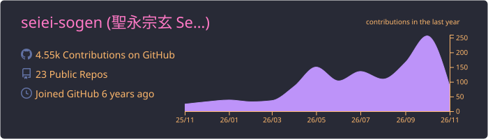
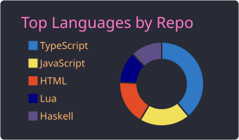
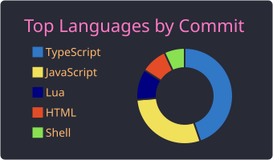
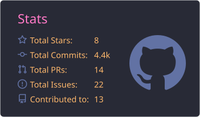
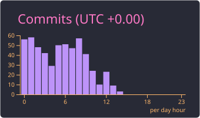

# 👋 Hi, I'm 聖永宗玄 (Seiei Sogen)

Software Developer / Engineer.

🌐 https://seiei-sogen.github.io/

  
  
  

## 📝 Zenn Articles

<!-- profile updater begin: zenn -->
- Nov 12 [【ドストエフスキー/罪と罰】口述筆記は努力か才能か](https://zenn.dev/purenium/articles/2026_11_12_dostoevsky_voice_input_talent_or_skill)
- Nov 11 [LLMと包丁のメタファー](https://zenn.dev/purenium/articles/2026_11_11_llm_is_sharp_but_bad_at_cutting)
- Nov 11 [LLMと包丁のメタファー](https://zenn.dev/purenium/articles/2026_11_11_llm_and_knife)
- May 25 [Rust + axum で画像掲示板を作る (3) SQLite + sqlx 接続とマイグレーション](https://zenn.dev/purenium/articles/2026_05_25_rust-axum-imgbbs-03-sqlx-migration)
- May 23 [Rust + axum で画像掲示板を作る (2) tracing と TraceLayer で開発体験を整える](https://zenn.dev/purenium/articles/2026_05_23_rust-axum-imgbbs-02-tracing)
- May 22 [Rust + axum で画像掲示板を作る (1) プロジェクト初期化と Hello, axum!](https://zenn.dev/purenium/articles/2026_05_22_rust-axum-imgbbs-01-init)
- May 8 [仏教アビダンマの四相分析をClaude Code / Codex CLIのSkillにした](https://zenn.dev/purenium/articles/2026_05_08_lakkhanadi-catukka-analyzer)
- Oct 4 [オブジェクト指向無本質論【後期ウィトゲンシュタイン/家族的類似性】―「本当のオブジェクト指向」はない](https://zenn.dev/purenium/articles/2025_10_04_object-oriented-family-resemblance)
- Nov 1 [いかにして『型』は人を救うか。【ウィトゲンシュタイン / 千葉雅也】](https://zenn.dev/purenium/articles/2024_11_01_how_type_systems_can_save_humans)
- Oct 31 [テストとは《写像》である～なぜ自動テストが書けないのか～](https://zenn.dev/purenium/articles/2024_11_31_test_is_a_mapping)
<!-- profile updater end: zenn -->

## 📊 GitHub Stats

## 🛠 Languages and Tools

  
  
  
  
  
  
  
  
  
  
  
  
  
  
  
  
  
  
  
  
  
  
  
  
  
  
  
  

## 🚀 Developments

### Next.js

- 📦 [seiei-sogen/nextjs-sg-use-swr-gourmet-search-0](https://github.com/seiei-sogen/nextjs-sg-use-swr-gourmet-search-0)
- 📦 [seiei-sogen/nextjs-sg-use-swr-strong-consistency-0](https://github.com/seiei-sogen/nextjs-sg-use-swr-strong-consistency-0)
- 📦 [seiei-sogen/nextjs-recoil-tic-tac-toe-0](https://github.com/seiei-sogen/nextjs-recoil-tic-tac-toe-0)

<!--
**seiei-sogen/seiei-sogen** is a ✨ _special_ ✨ repository because its `README.md` (this file) appears on your GitHub profile.

Here are some ideas to get you started:

- 🔭 I’m currently working on ...
- 🌱 I’m currently learning ...
- 👯 I’m looking to collaborate on ...
- 🤔 I’m looking for help with ...
- 💬 Ask me about ...
- 📫 How to reach me: ...
- 😄 Pronouns: ...
- ⚡ Fun fact: ...

参考ページ

【個人開発】Githubのプロフィールに、Qiita・Zennの記事などを一覧表示させる、Github Actionsのアクション作ったよ！
https://qiita.com/kumackey/items/5bf3dec679f6888d9d4b

GitHubのプロフィールをカッコよくする方法② GitHub Profile Summary Cards編
https://zenn.dev/a_ichi1/articles/64f353e23408b9

GitHub Readme Stats
https://github.com/anuraghazra/github-readme-stats#github-stats-card

-->
